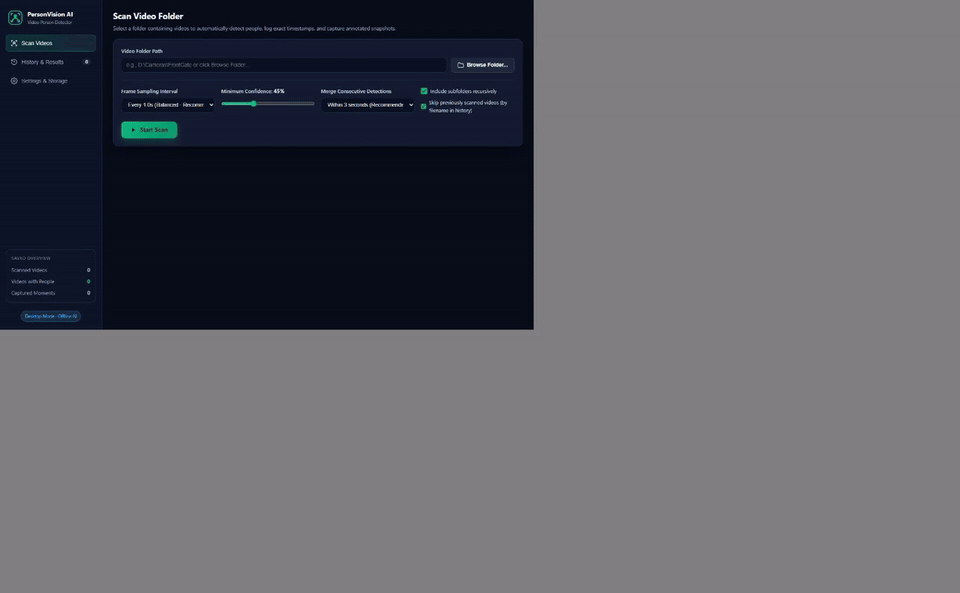
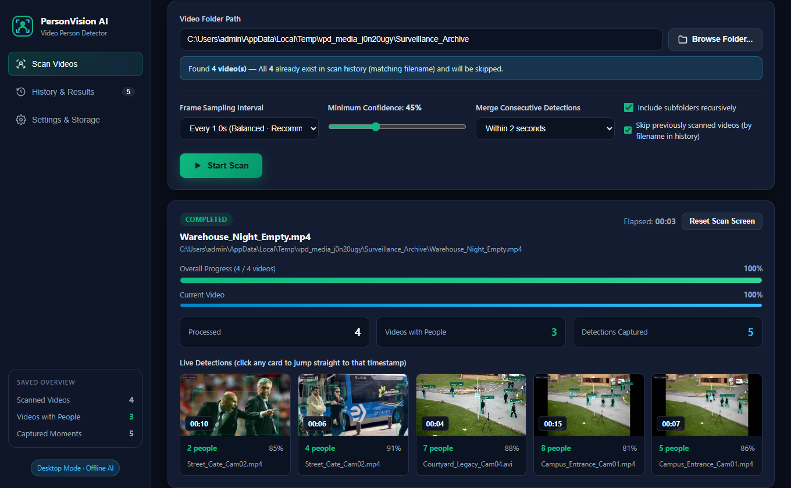
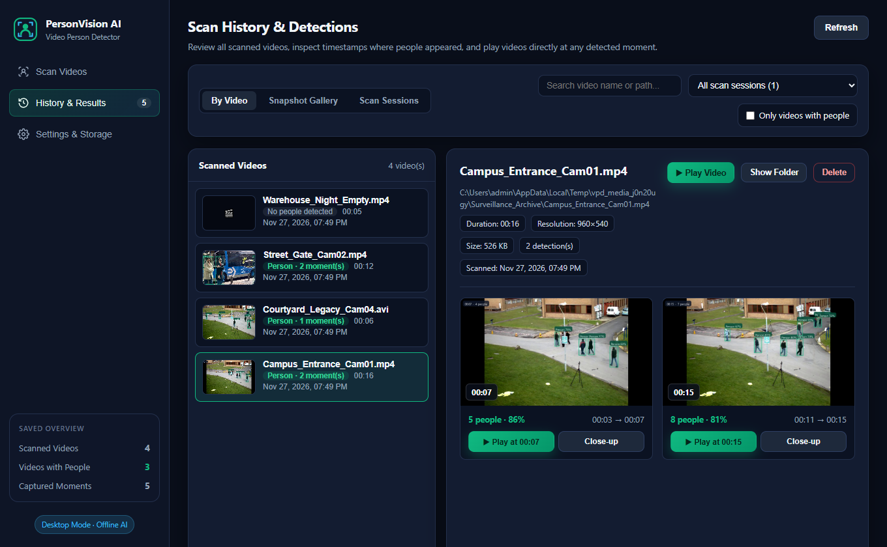
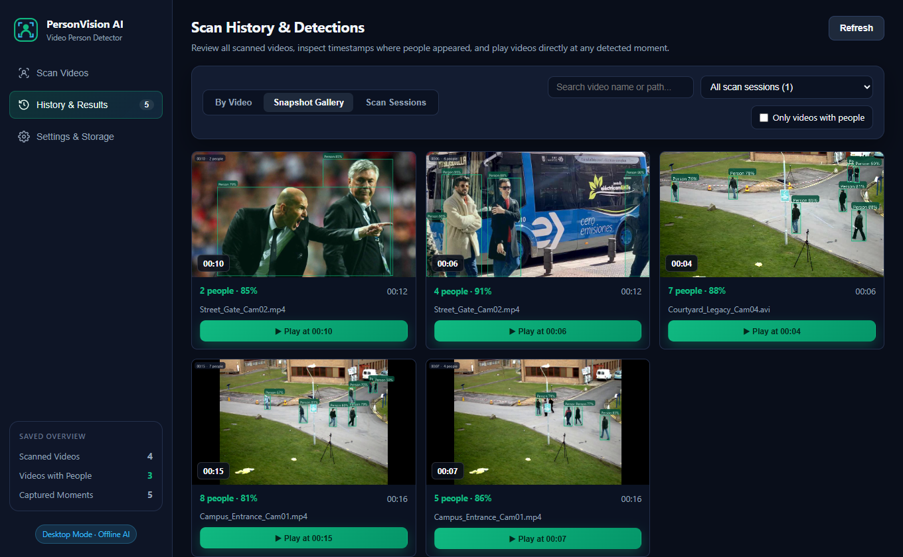
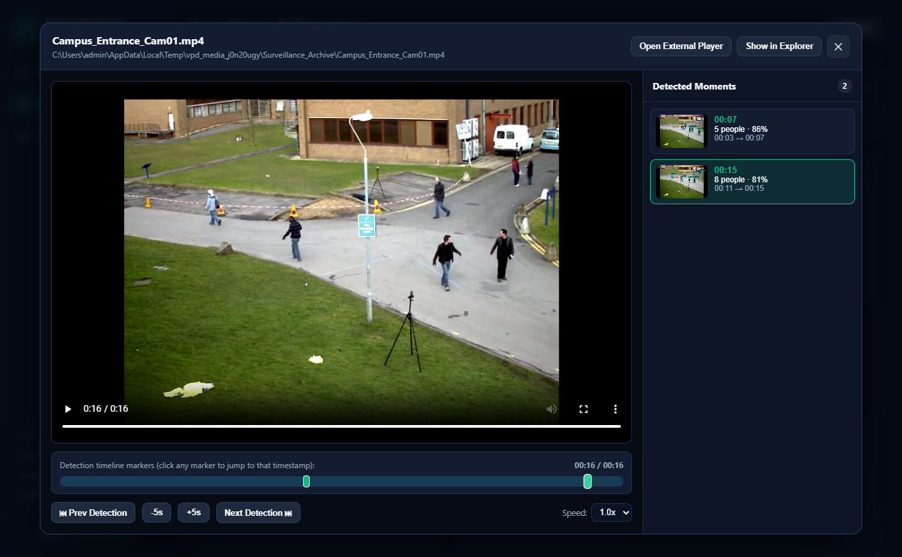
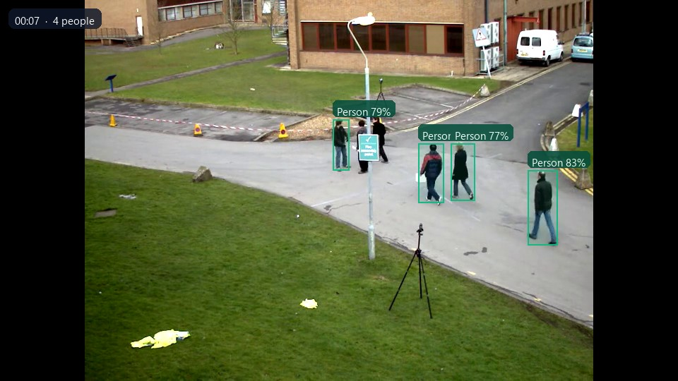
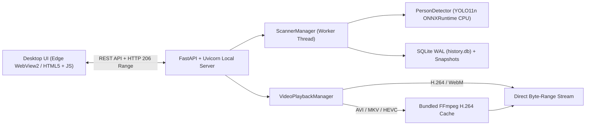

# PersonVision AI — Offline Video Person Detector

> A lightweight, fully portable Windows desktop application powered by **YOLO11n ONNX**, **ONNX Runtime**, **FastAPI**, and **Edge WebView2** that scans local video folders to detect human appearances, log exact timestamps, capture annotated snapshots, and play videos directly at any detected moment.

-0078D6?logo=windows)


---

## Overview

Reviewing hours of CCTV, security, or dashcam footage manually is slow and error-prone. **PersonVision AI** automates human detection across entire video directories on standard CPU hardware — with **zero cloud dependencies**, **zero GPU requirements**, and **zero environment setup** on target machines.

Key user outcomes:
- **Folder-Scale Batch Scanning:** Point to any folder (with optional recursive subfolder traversal) across `.mp4`, `.avi`, `.mov`, `.mkv`, `.wmv`, `.flv`, `.webm`, `.m4v`, `.ts`, `.mpg`, and `.3gp`.
- **Smart Snapshot Capture:** Saves both an annotated full-frame image (emerald bounding boxes, confidence badge, person count, and timestamp overlay) and a padded close-up crop of the primary detected person.
- **Persistent Portable History:** Stores every scan session, video metadata, and detection segment in a local SQLite database (`WAL` mode) with relative snapshot paths — allowing the entire application + history to be moved between machines via USB or archive.
- **Instant Jump-to-Timestamp Playback:** Clicking any snapshot or timeline marker inside the built-in theater player seeks directly to that exact timestamp (`video.currentTime`), automatically transcoding legacy formats (`.avi`, `.mkv`, `.wmv`, HEVC) via bundled FFmpeg when needed.
- **Duplicate-Safe Re-Scanning:** Automatically skips previously scanned videos (matched by filename against history) and clearly reports how many files were skipped vs. newly scanned.

---

## Product Demo & Screenshots

<div align="center">
  
  <p><em>End-to-end walkthrough: batch folder scanning, live detection feed, history inspection, and instant jump-to-timestamp playback.</em></p>
  <p>Prefer full-resolution MP4? <a href="docs/media/PersonVisionAI_Demo.mp4">Watch / Download PersonVisionAI_Demo.mp4</a> (also attached to <a href="https://github.com/phamduythai92mta/PersonVisionAI/releases/tag/v1.0.0">Release v1.0.0</a>).</p>
</div>

| Folder Scan & Live Detections | History & Per-Video Timestamps |
| :---: | :---: |
|  |  |

| Snapshot Gallery | Built-in Player with Timeline Markers |
| :---: | :---: |
|  |  |

<details>
<summary><strong>Sample AI Detection Output (YOLO11n ONNX Bounding Boxes &amp; Timestamp Badge)</strong></summary>
<br />
<p align="center">
  
</p>
</details>

---

## System Architecture



### Engineering Decisions & Trade-offs

| Decision | Rationale |
| :--- | :--- |
| **ONNX Runtime + `yolo11n.onnx` (~10.2 MB) instead of PyTorch** | Bundling `torch` + `ultralytics` inflates a Windows distribution past 1.5–2 GB. Exporting YOLO11n to static `640×640` ONNX reduces the compressed portable package to **~147 MB**, cuts cold startup under 2 seconds, and runs cleanly on standard x64 CPUs. |
| **Adaptive Frame Stepping (`cap.grab()` vs `CAP_PROP_POS_FRAMES`)** | For short sampling intervals (`<= 120` frames), `cap.grab()` skips decoding un-sampled frames without keyframe seek inaccuracies on poorly indexed `.avi`/`.ts` streams. For longer intervals, direct frame seeking avoids unnecessary demux overhead. |
| **Temporal Event Clustering** | Consecutive frame detections within a configurable merge window (default `3s`, capped at `15s` segments) are grouped into a single event keeping the highest-confidence frame, preventing hundreds of duplicate snapshots for a stationary subject. |
| **Zero-Install Cross-Format Playback** | Browser `<video>` natively streams H.264/WebM via HTTP `206 Partial Content`. Non-browser containers/codecs (`.avi`, `.mkv`, `.wmv`, HEVC) are automatically transcoded on demand using the bundled `imageio-ffmpeg` binary and cached locally. |
| **Portable `data/` Resolution + File Relocation** | History databases store relative snapshot paths alongside `data/` next to the `.exe` (falling back to `%LOCALAPPDATA%` if read-only). If video drives change on another PC, **"Relocate Video File..."** updates the path and auto-remaps sibling files from the same directory. |

---

## Quick Start

### Option 1: Portable Windows Executable (End Users)

1. Download **`PersonVisionAI_Portable.zip`** from the [Releases](../../releases) page.
2. Extract the archive to any writable folder (e.g., `D:\Apps\PersonVisionAI`).
3. Double-click **`PersonVisionAI.exe`**.
   - *No Python, OpenCV, FFmpeg, or external model downloads required.*
   - *Note:* On first launch, if Windows Defender SmartScreen shows a warning for an unsigned binary, click **More info** → **Run anyway**.

### Option 2: Run from Source (Developers)

**Prerequisites:** Windows 10/11 (64-bit) and **Python 3.11**.

```powershell
# 1. Create a Python 3.11 virtual environment
uv venv --python 3.11 .venv
# Or: py -3.11 -m venv .venv

# 2. Install dependencies
uv pip install --python .venv\Scripts\python.exe -r requirements.txt
# Or: .\.venv\Scripts\pip install -r requirements.txt

# 3. Launch the desktop application
.\.venv\Scripts\python.exe main.py
```

### Build the Portable Distribution Yourself

```powershell
powershell -ExecutionPolicy Bypass -File build_package.ps1
```

Outputs:
- Standalone folder: `dist\PersonVisionAI\PersonVisionAI.exe`
- Portable archive: `dist\PersonVisionAI_Portable.zip`

---

## Project Structure

```text
VideoPersonDetector/
├── main.py                  # Desktop launcher (Uvicorn + PyWebView Edge WebView2 with browser app-mode fallback)
├── backend/
│   ├── paths.py             # Frozen resource (_MEIPASS) & portable data directory resolution
│   ├── database.py          # Thread-safe SQLite WAL persistence for sessions, videos, detections & settings
│   ├── detector.py          # YOLO11n ONNX preprocessing, NMS postprocessing, and Pillow snapshot annotation
│   ├── scanner.py           # Background folder scanner, filename deduplication, pause/stop, event clustering
│   ├── video_service.py     # HTTP 206 byte-range streaming & FFmpeg H.264 preview transcoding cache
│   └── api.py               # FastAPI endpoints & native Windows folder/file picker integration
├── web/
│   ├── index.html           # Offline desktop UI shell (Scan, History & Results, Settings, Theater Player)
│   ├── styles.css           # Dark studio theme, responsive grids, interactive timeline markers
│   └── app.js               # State management, live scan polling, gallery views, seek-to-timestamp player
├── models/
│   └── yolo11n.onnx         # Bundled YOLO11n ONNX person detection model
├── assets/
│   └── icon.ico             # Windows application icon
├── build.spec               # PyInstaller --onedir build specification
├── build_package.ps1        # Automated build & portable ZIP packaging script
├── requirements.txt         # Pinned runtime & build dependencies
└── LICENSE                  # MIT License
```

---

## Usage Workflow

1. **Scan Videos:** Choose a target folder, adjust sampling interval (`0.5s – 5s`), confidence threshold (`25% – 85%`), and merge window. Duplicate videos already recorded in history are skipped automatically with a status summary.
2. **Review History:** Filter scanned videos by scan session, filename, or *"Only videos with people"*. Switch seamlessly between **By Video**, **Snapshot Gallery**, and **Scan Sessions**.
3. **Play at Timestamp:** Click any captured snapshot or timeline pin to launch the built-in player directly at that moment, step between detections, adjust playback speed (`0.5x – 2.0x`), or open the file externally.

---

## License

Released under the [MIT License](LICENSE).
